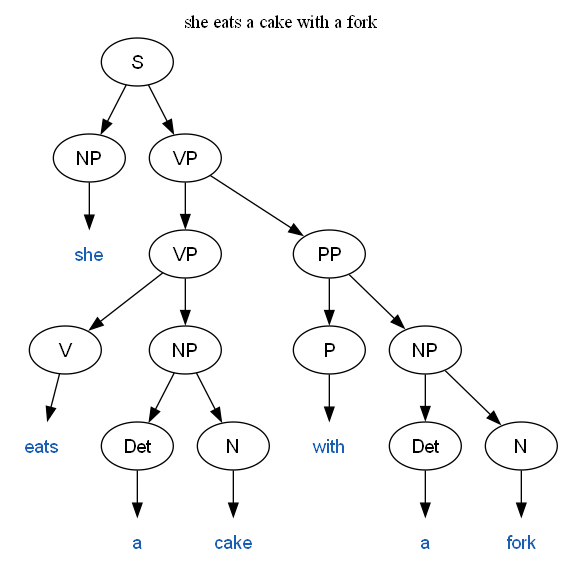
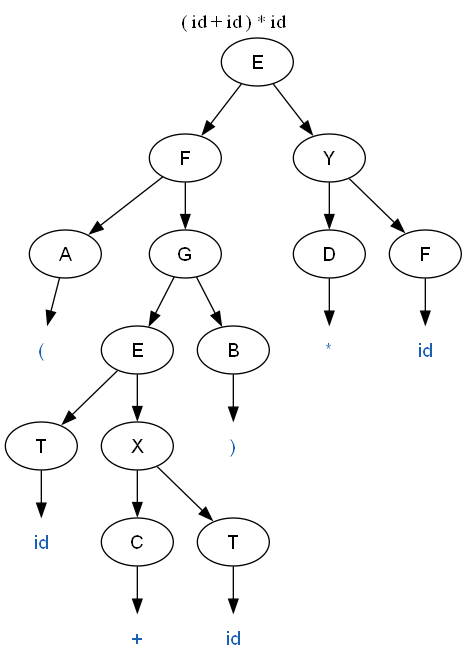
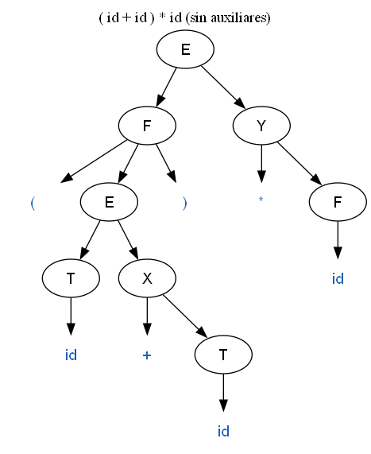

# Proyecto 2 – Algoritmo CYK

Teoría de la Computación – Octubre 2025

Programa en Python que:

1. Lee una gramática libre de contexto (CFG) desde un archivo de texto.
2. La **simplifica y la convierte a Forma Normal de Chomsky (CNF)**.
3. Usa el **algoritmo CYK** (programación dinámica) para decidir si una frase pertenece al lenguaje de la gramática.
4. Muestra **SÍ / NO**, el **tiempo** que tardó el CYK y el **árbol de parseo** (en consola y como imagen).

No necesita librerías externas. Si Graphviz está instalado (comando `dot`), el árbol también se guarda como `.png`. Si no está, se guarda solo el `.dot`.

---

## 1. Cómo usarlo

Requisito: Python 3.8 o más reciente.

```bash
# modo interactivo con la gramática en inglés del enunciado
python main.py

# una sola frase
python main.py "She eats a cake with a fork"

# ver también la tabla del CYK
python main.py --tabla "The cat drinks the beer"

# otra gramática, viendo paso a paso la conversión a CNF
python main.py -g gramaticas/1.txt --pasos "( id + id ) * id"

# correr todas las pruebas
python pruebas.py
```

| Opción | Qué hace |
|---|---|
| `-g ARCHIVO` | Gramática a usar (por defecto `gramaticas/ingles.txt`) |
| `--pasos` | Muestra la gramática después de cada paso de la conversión a CNF |
| `--tabla` | Imprime la tabla triangular del CYK |
| `--sin-imagen` | No genera la imagen del árbol |
| `--max-arboles N` | Si la frase es ambigua, cuántos árboles mostrar (por defecto 3) |

Al arrancar, el programa también guarda la gramática convertida en `gramaticas/<nombre>-cnf.txt`.

### Formato de la gramática

Es el mismo formato de los archivos del profesor:

```
E -> T X
X -> + T X | e
T -> F Y
Y -> * F Y | e
F -> ( E ) | id
```

- Lo que está a la izquierda de `->` es una variable. Todo lo que nunca aparece a la izquierda es terminal.
- Los símbolos se separan con espacios. Las alternativas se separan con `|`.
- `e` (o `ε`) es epsilon.
- La variable inicial es la de la primera regla.
- Las líneas que empiezan con `#` son comentarios.

### Formato de la frase

Las palabras se separan por espacios. Se pasa todo a minúsculas (`She` = `she`) y se quitan los signos de puntuación pegados a una palabra (`beer.` → `beer`), salvo que ese signo sea un terminal de la gramática (como `(` y `)` en la gramática de expresiones). Por eso en esa gramática hay que escribir `( id + id )` con espacios.

---

## 2. Diseño de la aplicación

### Estructura de archivos

```
Proyecto2_CYK/
├── main.py          programa principal (entrada, salida, tiempo)
├── gramatica.py     clase Gramatica + lectura del archivo
├── cnf.py           simplificación y conversión a CNF
├── cyk.py           algoritmo CYK, tabla, construcción del árbol
├── arbol.py         impresión del árbol (consola, corchetes, Graphviz)
├── pruebas.py       casos de prueba y verificación de la CNF
├── gramaticas/
│   ├── ingles.txt           gramática del enunciado
│   ├── 1.txt                gramática de expresiones (del profesor)
│   ├── 1-cnf-profesor.txt   la CNF que dio el profesor, para comparar
│   └── extra.txt            gramática inventada para probar todos los pasos
└── arboles/         aquí se guardan las imágenes de los árboles
```

### Flujo del programa

```
archivo .txt ──► leer_gramatica() ──► convertir_a_cnf() ──► gramática CNF
                                                               │
frase w ──► tokenizar() ──► lista de palabras ──► cyk() ◄──────┘
                                                    │
                          tabla con backpointers ◄──┘
                                    │
               ┌────────────────────┼─────────────────────┐
           SÍ / NO           construir_arbol()       tiempo (perf_counter)
                                    │
                    consola / corchetes / imagen .png
```

### Cómo se guarda la gramática

La clase `Gramatica` tiene:

- `inicial`: la variable inicial.
- `producciones`: un diccionario `variable -> lista de tuplas`. Cada tupla es un lado derecho; la tupla vacía `()` es epsilon.

Ejemplo: `NP -> Det N | he | she` queda como `{"NP": [("Det","N"), ("he",), ("she",)]}`.

Como un símbolo es variable si y solo si es llave del diccionario, no hace falta guardar aparte la lista de terminales.

### Simplificación y conversión a CNF (`cnf.py`)

Una gramática está en CNF si todas sus producciones son `A -> B C` (dos variables) o `A -> a` (un terminal). Solo la inicial puede tener `S -> e`, si el lenguaje incluye la cadena vacía.

Los pasos se aplican en este orden:

| Paso | Función | Qué hace |
|---|---|---|
| 1 | `eliminar_epsilon` | Calcula las variables **anulables** (punto fijo: A es anulable si tiene un cuerpo de puros anulables). Por cada producción agrega todas las versiones que salen de quitar o dejar cada símbolo anulable, y borra las `A -> e`. Si la inicial era anulable, crea una inicial nueva `S0 -> S \| e`. |
| 2 | `eliminar_unitarias` | Calcula los **pares unitarios** (A, B) tales que A ⇒* B usando solo producciones `X -> Y`. A cada A le copia todas las producciones no unitarias de cada B. |
| 3 | `eliminar_inutiles` | Primero quita las variables **no generadoras** (las que nunca llegan a una cadena de puros terminales) y después las **no alcanzables** desde la inicial. El orden importa: si se hace al revés pueden quedar símbolos inútiles. |
| 4 | `reemplazar_terminales` | En producciones de largo ≥ 2, cambia cada terminal `a` por una variable nueva `X -> a` (la misma para todas las veces que aparece `a`). |
| 5 | `binarizar` | Parte `A -> X1 X2 ... Xn` (n > 2) en `A -> X1 Y1`, `Y1 -> X2 Y2`, …, por la derecha. Si la misma "cola" aparece en varias producciones, se reutiliza la misma variable. |

Las variables nuevas reciben letras libres (A, B, C, …), como en el ejemplo del profesor. Si se acaban las letras, se usa `X1`, `X2`, etc. Las variables creadas en los pasos 4 y 5 se guardan en un conjunto `auxiliares`, que sirve para reconstruir el árbol con la forma de la gramática original.

Al final, `es_cnf()` revisa que el resultado de verdad esté en CNF.

**Resultado con la gramática del profesor (`1.txt`)**:

```
E -> T X | F Y | id | A G
X -> C T | C H
T -> F Y | id | A G
Y -> D F | D I
F -> id | A G
A -> (
B -> )
C -> +
D -> *
G -> E B
H -> T X
I -> F Y
```

Es la misma gramática que `1-cnf.txt` del profesor (20 producciones). Solo cambian los nombres de las variables nuevas:

| Profesor | Nuestro programa | Producción |
|---|---|---|
| L | A | `-> (` |
| R | B | `-> )` |
| P | C | `-> +` |
| M | D | `-> *` |
| Z | G | `-> E )` |
| W | H | `-> T X` |
| V | I | `-> F Y` |

**La gramática en inglés ya está en CNF.** Todas sus producciones son de dos variables o de un terminal, así que los 5 pasos no le cambian nada (no hay epsilon, ni unitarias, ni símbolos inútiles). Para comprobar que la conversión sí funciona se usaron `1.txt` y `extra.txt`. Esta última está hecha a propósito para tener de todo: epsilon, unitarias, una variable no generadora (`D -> D d`), variables no alcanzables, terminales mezclados con variables y producciones de largo 3. Con `--pasos` se puede ver cada paso:

```
python main.py -g gramaticas/extra.txt --pasos "a c b b"
```

### Algoritmo CYK (`cyk.py`)

Se usa **programación dinámica**: el problema grande ("¿S genera toda la frase?") se resuelve combinando las respuestas de subproblemas más pequeños ("¿qué variables generan las palabras i a j?"). Cada respuesta se guarda en una tabla para no recalcularla.

Para una frase w = w₀ … wₙ₋₁:

- `tabla[i][j]` = conjunto de variables que generan las palabras de la i a la j.
- **Caso base (largo 1)**: `tabla[i][i] = { A | A -> wᵢ }`.
- **Caso general (largo 2 … n)**: para cada punto de corte k con i ≤ k < j, si `B ∈ tabla[i][k]`, `C ∈ tabla[k+1][j]` y existe `A -> B C`, entonces `A ∈ tabla[i][j]`.
- **Respuesta**: w está en el lenguaje si y solo si `S ∈ tabla[0][n-1]`.

```
para largo = 2 hasta n:
    para i = 0 hasta n - largo:
        j = i + largo - 1
        para k = i hasta j - 1:
            para cada B en tabla[i][k], C en tabla[k+1][j]:
                para cada A con A -> B C:
                    agregar A a tabla[i][j]   (y guardar (k, B, C))
```

Detalles de la implementación:

- **Índices invertidos**: antes de correr el CYK se arman dos diccionarios, `por_terminal["cat"] = ["N"]` y `por_par[("Det","N")] = ["NP"]`. Así, en cada celda no hay que recorrer toda la gramática buscando producciones.
- **Backpointers en vez de booleanos**: cada celda no guarda solo la variable, sino un diccionario `variable -> lista de (k, B, C)` que dice *de dónde salió*. Esto es lo que pide el enunciado para poder armar el árbol.
- **Complejidad**: O(n³ · |G|) en tiempo y O(n² · |V|) en memoria.

### Árbol de parseo (`cyk.py` + `arbol.py`)

`construir_arbol(tabla, S, 0, n-1)` sigue los backpointers de forma recursiva desde la celda de arriba. Si el backpointer es `(k, B, C)`, el nodo tiene dos hijos: el árbol de B en `[i..k]` y el de C en `[k+1..j]`. Si es una hoja, el hijo es la palabra.

También se calcula **cuántos árboles distintos** existen (`contar_arboles`, con memoización). Si son más de 1, la frase es **ambigua** y se muestran varios árboles.

El árbol se muestra de tres formas:

1. Dibujo en consola (`├──`, `└──`).
2. Notación de corchetes: `[S [NP she] [VP ...]]`.
3. Imagen con Graphviz, en `arboles/arbol_N.png`.

Además, si la gramática tenía variables auxiliares (pasos 4 y 5), se muestra un segundo árbol **sin esas variables**. Se "deshacen" metiendo sus hijos directamente en el padre, así que el árbol vuelve a verse con las reglas originales (por ejemplo `F -> ( E )` en lugar de `F -> A G`, `G -> E B`).

---

## 3. Ejemplos y pruebas

### Ejemplo de salida

```
$ python main.py --tabla "She eats a cake with a fork"

Frase: She eats a cake with a fork
Palabras: ['she', 'eats', 'a', 'cake', 'with', 'a', 'fork']
Resultado: SÍ pertenece al lenguaje
Tiempo del algoritmo CYK: 0.0409 ms (0.0000409 s)

Tabla CYK (cada celda tiene las variables que generan ese pedazo):
largo 7 |  S   |
largo 6 |  -   |  VP  |
largo 5 |  -   |  -   |  -   |
largo 4 |  S   |  -   |  -   |  -   |
largo 3 |  -   |  VP  |  -   |  -   |  PP  |
largo 2 |  S   |  -   |  NP  |  -   |  -   |  NP  |
largo 1 |  NP  | V,VP | Det  |  N   |  P   | Det  |  N   |
        | she  | eats |  a   | cake | with |  a   | fork |

Arbol de parseo (gramatica en CNF):
S
├── NP
│   └── "she"
└── VP
    ├── VP
    │   ├── V
    │   │   └── "eats"
    │   └── NP
    │       ├── Det
    │       │   └── "a"
    │       └── N
    │           └── "cake"
    └── PP
        ├── P
        │   └── "with"
        └── NP
            ├── Det
            │   └── "a"
            └── N
                └── "fork"

Notacion de corchetes: [S [NP she] [VP [VP [V eats] [NP [Det a] [N cake]]] [PP [P with] [NP [Det a] [N fork]]]]]
Imagen del arbol guardada en: arboles/arbol_1.png
```



Con la gramática de expresiones, `( id + id ) * id` (izquierda: árbol en CNF; derecha: sin variables auxiliares):

<p>


</p>

Ejemplo de una frase rechazada:

```
Frase: The cat drinks the milk
Palabras: ['the', 'cat', 'drinks', 'the', 'milk']
Resultado: NO pertenece al lenguaje
Tiempo del algoritmo CYK: 0.0244 ms (0.0000244 s)
Palabras que no estan en el vocabulario de la gramatica: milk
```

### Frases que SÍ están en el lenguaje (gramática en inglés)

| Frase | Resultado | Tiempo (ms) |
|---|---|---|
| She eats a cake with a fork | SÍ | 0.2475* |
| The cat drinks the beer | SÍ | 0.0206 |
| he cooks | SÍ | 0.0056 |
| she eats | SÍ | 0.0033 |
| The dog eats the meat | SÍ | 0.0126 |
| he cuts the cake with a knife | SÍ | 0.0215 |
| She cooks the soup in the oven | SÍ | 0.0244 |
| the cat drinks the juice with a spoon | SÍ | 0.0270 |
| he eats a cake with a fork in the oven | SÍ | 0.0442 |
| the dog cuts a meat with a knife with a fork | SÍ | 0.0496 |
| She drinks the beer. | SÍ | 0.0120 |
| A cat eats a dog | SÍ | 0.0119 |
| he eats in the oven | SÍ | 0.0116 |

\* La primera frase siempre tarda más porque es la primera ejecución (Python todavía está "calentando").

"A cat eats a dog" o "the dog cuts a meat…" no tienen mucho sentido, pero son **sintácticamente** correctas, que es lo único que revisa la gramática (como dice el enunciado).

### Frases que NO están en el lenguaje (gramática en inglés)

| Frase | Por qué no | Resultado |
|---|---|---|
| *(vacía)* | la gramática no genera ε | NO |
| she | falta el verbo (VP) | NO |
| eats | falta el sujeto (NP) | NO |
| the cat | falta el verbo | NO |
| cat drinks the beer | `cat` sin determinante no es NP | NO |
| She eats cake | `cake` sin determinante | NO |
| the cat the dog | no hay verbo | NO |
| He eats a cake with | PP incompleto (`with` sin NP) | NO |
| she eats a fork a knife | dos NP seguidos sin preposición | NO |
| The cat drinks the milk | `milk` no está en el vocabulario | NO |
| eats she the cake | orden incorrecto | NO |
| she he eats | dos sujetos | NO |
| with a fork she eats a cake | la gramática no permite PP al inicio | NO |
| she eats the the cake | doble determinante | NO |
| a the cat drinks | doble determinante | NO |

Las 28 frases dieron el resultado esperado. Ninguna de las aceptadas resultó ambigua: con esta gramática el PP solo se puede pegar al VP (`VP -> VP PP`) y no al NP, así que hay un solo árbol posible.

### Gramática de expresiones (`1.txt`)

- **Aceptadas**: `id`, `id + id`, `id * id`, `id + id * id`, `( id )`, `( id + id ) * id`, `( ( id ) )`, `id * ( id + id ) * id`, `id + id + id + id`
- **Rechazadas**: *(vacía)*, `+`, `id +`, `id id`, `( id`, `id )`, `( )`, `* id`, `id + * id`, `( id + ) id`

Las 19 dieron el resultado esperado.

### Verificación de que la conversión a CNF no cambia el lenguaje

Probar unas cuantas frases a mano no garantiza que la conversión esté bien. Por eso `pruebas.py` hace una prueba más fuerte:

1. Con la gramática **original** (sin convertir) genera por fuerza bruta todas las cadenas de largo ≤ L, haciendo derivaciones por la izquierda.
2. Con el CYK sobre la gramática **en CNF** prueba **todas** las combinaciones posibles de terminales de largo ≤ L.
3. Compara: el CYK debe aceptar exactamente las cadenas generadas en el paso 1.

```
1.txt        largo <= 6:  19531 cadenas probadas,   15 en el lenguaje, 0 diferencias -> OK
extra.txt    largo <= 7:  21845 cadenas probadas,  376 en el lenguaje, 0 diferencias -> OK
ingles.txt   largo <= 4: 204205 cadenas probadas,  496 en el lenguaje, 0 diferencias -> OK
```

### Tiempo vs. largo de la frase

Se le fueron agregando "with a fork" a "she eats a cake" (mejor tiempo de 20 corridas):

| Palabras | Tiempo (ms) |
|---|---|
| 4 | 0.0126 |
| 7 | 0.0329 |
| 10 | 0.0635 |
| 16 | 0.1484 |
| 28 | 0.3225 |
| 52 | 1.6796 |
| 100 | 10.4143 |

Al duplicar el largo, el tiempo se multiplica más o menos por 5 o 6. Es menos que el ×8 que daría O(n³) puro, porque muchas celdas de la tabla quedan vacías y el programa se las salta. Aun así, el crecimiento es claramente polinomial. Para frases normales (menos de 15 palabras) el CYK tarda menos de un décimo de milisegundo.

---

## 4. Discusión

### Obstáculos encontrados

- **El orden de los pasos de la CNF importa.** Si se eliminan las unitarias antes que las epsilon, al quitar las epsilon aparecen unitarias nuevas (por ejemplo `E -> T X` con X anulable deja `E -> T`). Pasa lo mismo con los símbolos inútiles: hay que quitar primero los no generadores y después los no alcanzables. Al revés pueden quedar variables que ya no se alcanzan.
- **La cadena vacía.** Si la inicial es anulable, al quitar las epsilon se perdería ε del lenguaje. Por eso se crea una inicial nueva `S0 -> S | e`, que además no aparece del lado derecho de ninguna regla.
- **Terminales vs. variables.** El archivo no dice qué es terminal, así que se definió que es variable todo lo que aparece del lado izquierdo de una regla. Por eso se leen todas las líneas antes de armar las producciones. También hubo que decidir qué hacer con `e`: se toma como epsilon, así que no se puede usar como terminal.
- **Puntuación y mayúsculas.** "She" y "she" deben ser la misma palabra, y "beer." debería aceptarse. Pero en la gramática de expresiones `(` y `)` sí son terminales y no se pueden borrar. Por eso solo se quita la puntuación cuando el signo no es un terminal de la gramática.
- **El árbol no se parece a la gramática original.** Después de la CNF, el árbol tiene variables inventadas (`A -> (`, `G -> E B`…) que confunden. Se resolvió marcando esas variables y "aplanándolas" al mostrar el árbol. Lo que no se puede recuperar son los nodos que se perdieron al eliminar las unitarias (por ejemplo `E -> T -> F`). Para eso habría que guardar la cadena de unitarias de cada producción.
- **Ambigüedad.** Al guardar todos los backpointers aparecieron frases con varios árboles (en `extra.txt`). Hay que tener cuidado al listarlos, porque la cantidad puede crecer de forma exponencial. Por eso se cuentan con memoización y solo se muestran los primeros N.
- **Medir el tiempo.** Las primeras mediciones eran muy inestables (una frase de 52 palabras tardaba casi lo mismo que una de 100). El ruido viene del sistema operativo y del recolector de basura de Python. Se usa `time.perf_counter()` (el reloj más preciso de Python) y, en las pruebas, se toma el mínimo de varias corridas en vez del promedio.

### Recomendaciones

- Usar diccionarios por par `(B, C)` en lugar de recorrer todas las producciones en cada celda. Hace una gran diferencia cuando la gramática es grande.
- Probar la conversión a CNF con una gramática hecha para tener todos los casos (como `extra.txt`), porque la gramática del enunciado ya está en CNF y no prueba nada de la conversión.
- Comparar automáticamente el lenguaje de la gramática original con el de la CNF, en vez de confiar en unos cuantos ejemplos. Así se encuentran errores que a mano no se ven.
- Para gramáticas reales de lenguaje natural sería mejor una versión **probabilística** del CYK (PCFG), que escoge el árbol más probable cuando hay ambigüedad. También se podría usar Earley, que no necesita convertir a CNF.

---

## 5. Referencias

- Hopcroft, Motwani y Ullman. *Introduction to Automata Theory, Languages, and Computation*, cap. 7 (Forma Normal de Chomsky y algoritmo CYK).
- Jurafsky y Martin. *Speech and Language Processing*, cap. "Constituency Parsing" (CKY).
- Sipser. *Introduction to the Theory of Computation*, cap. 2 y 7.
